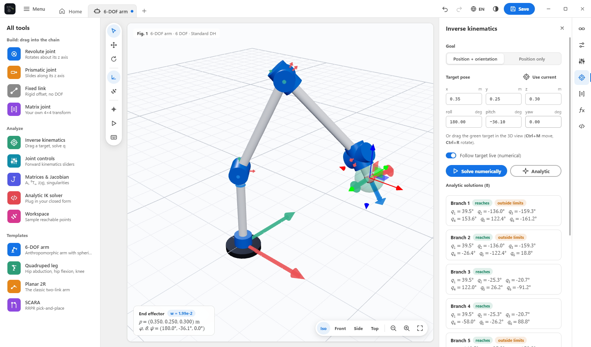
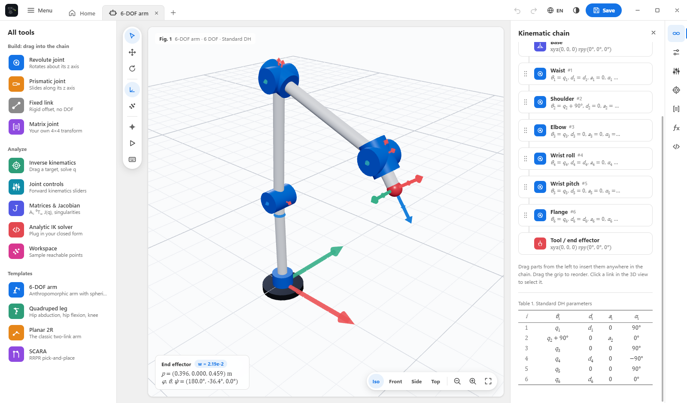
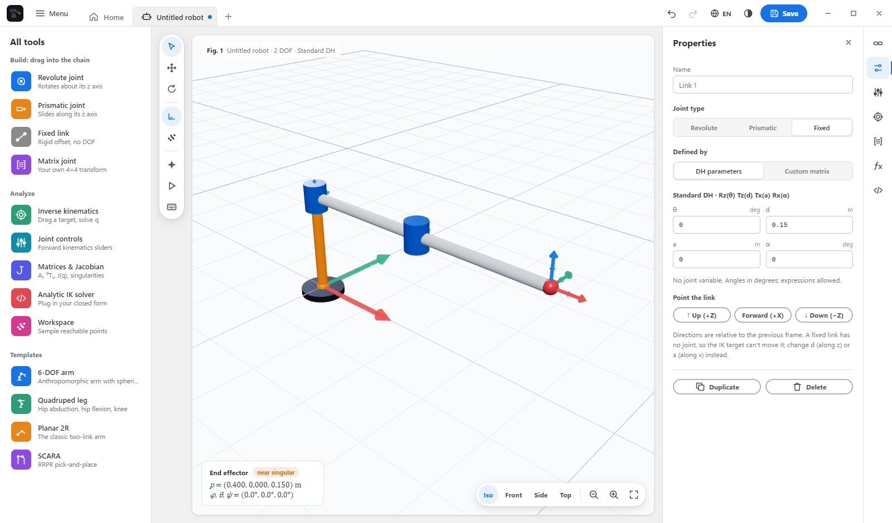
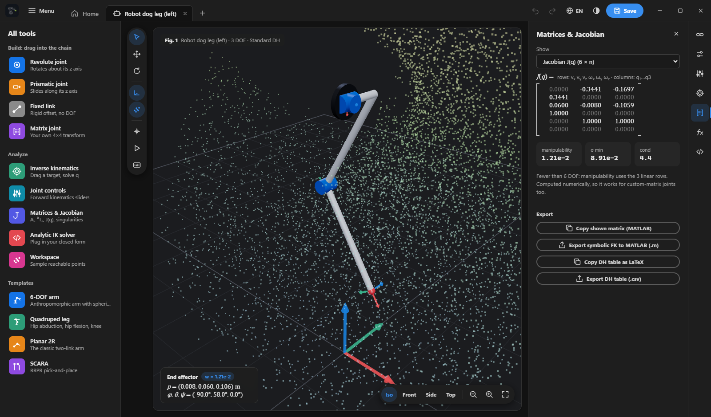
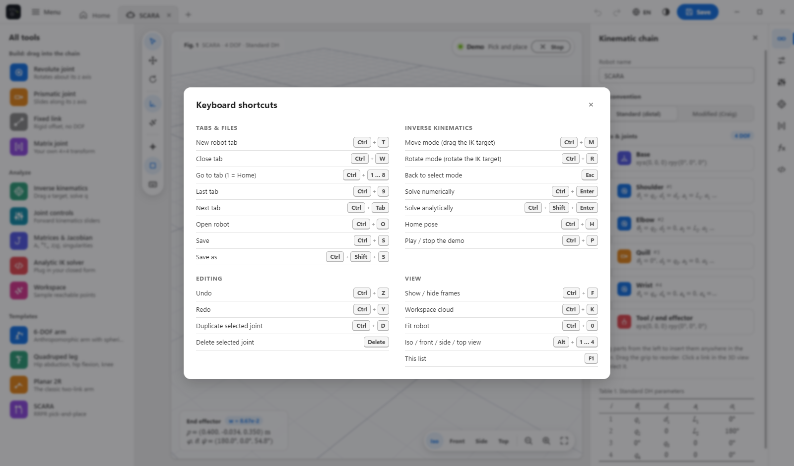
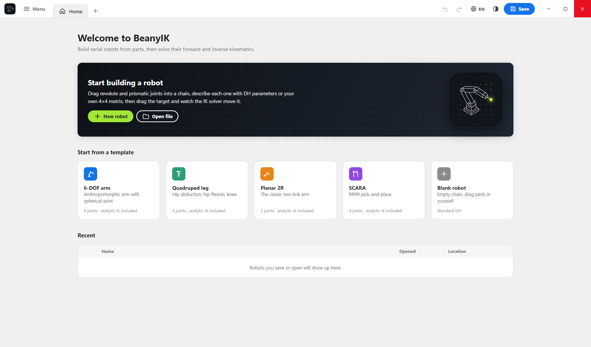

<p align="center">
  
</p>

<h1 align="center">BeanyIK</h1>

<p align="center">
  <b>Build a robot from parts, then make it reach.</b><br>
  A desktop app for robot kinematics: drag joints into a chain, describe them with DH parameters or your own
  4×4 matrices, and solve forward and inverse kinematics live in 3D.
</p>

<p align="center">
  <a href="https://github.com/greenythebeany/BeanyIK/releases/latest"></a>
  <a href="https://github.com/greenythebeany/BeanyIK/releases"></a>
  
  <a href="LICENSE"></a>
</p>

<p align="center">
  <b>English</b> · <a href="README.sk.md">Slovenčina</a> · <a href="https://greenythebeany.github.io/BeanyIK/">Website</a>
</p>

<p align="center">
  <a href="https://github.com/greenythebeany/BeanyIK/releases/latest">
    
  </a>
</p>

<p align="center">
  
</p>

---

## Contents

- [What it is](#what-it-is)
- [Showcase](#showcase)
- [Features](#features)
- [Templates](#templates)
- [Install](#install)
- [Quick guide](#quick-guide)
- [Units and conventions](#units-and-conventions)
- [Writing your own analytic IK](#writing-your-own-analytic-ik)
- [Keyboard shortcuts](#keyboard-shortcuts)
- [Updates](#updates)
- [FAQ](#faq)
- [Development](#development)
- [Terms, credits and license](#terms-credits-and-license)

## What it is

BeanyIK started as a tool for robotics and cybernetics coursework. You build the robot you are actually working
on (a 6-DOF arm, a robot dog leg, a SCARA), check your DH table against a real 3D model, drag a target around and
watch the solver move the arm. You can also plug in your own closed-form solution and compare it with the numerical one.

The interface is modelled on Adobe Acrobat: a tab bar, an **All tools** panel on the left, a quick-tools rail next
to the 3D view, and an icon rail on the right that opens panels. Kinematics is typeset like a textbook, with θᵢ, dᵢ, aᵢ and αᵢ,
a booktabs-style DH table, and matrices in square brackets.

## Showcase

Every template plays a demo when you open it. The planned path is dashed and the tool leaves a trail.

<table>
  <tr>
    <td width="50%"><br><sub><b>Quadruped leg</b>: stance and swing gait, solved by IK every frame</sub></td>
    <td width="50%"><br><sub><b>SCARA</b>: pick and place with the quill going up and down</sub></td>
  </tr>
  <tr>
    <td width="50%"><br><sub><b>Planar 2R</b>: the tip draws a figure eight</sub></td>
    <td width="50%"><br><sub><b>6-DOF arm</b>: a circle with the tool held pointing down</sub></td>
  </tr>
</table>

### Inverse kinematics

<p align="center">
  
</p>
<p align="center"><sub>The 6-DOF arm with a typed target. All eight closed-form branches are checked with forward kinematics and flagged if they break a joint limit.</sub></p>

### The chain and its DH table

<table>
  <tr>
    <td width="50%"><br><sub>Kinematic chain with the DH table, typeset like a paper</sub></td>
    <td width="50%"><br><sub>Properties of a link, with one-click directions for fixed links</sub></td>
  </tr>
  <tr>
    <td width="50%"><br><sub>Jacobian, manipulability and the workspace cloud (dark theme)</sub></td>
    <td width="50%"><br><sub>Your own closed-form IK, written right in the app</sub></td>
  </tr>
  <tr>
    <td width="50%"><br><sub>Several robots open as tabs, each with its own pose and undo</sub></td>
    <td width="50%"><br><sub>Every shortcut on one sheet (F1)</sub></td>
  </tr>
  <tr>
    <td width="50%"><br><sub>Home screen with templates and recent files</sub></td>
    <td width="50%"><br><sub>Dark theme</sub></td>
  </tr>
</table>

## Features

**Building**

- **Drag and drop chain builder.** Drag *Revolute*, *Prismatic*, *Fixed link* or *Matrix joint* parts from
  **All tools** anywhere into the chain, or drop them on the 3D view to append. Drag the grip to reorder, click to edit.
- **Standard (distal) or modified (Craig) DH** with θ, d, a and α per joint, joint limits and a home pose.
- **Point joints without thinking about DH.** Every joint has one-click buttons to tilt its rotation axis
  (0°, 90°, −90°, 180°) and to turn the link around it. BeanyIK sets the right α or θ for you.
- **Elementary transforms.** Build Aᵢ as a product of Rx, Ry, Rz, Tx, Ty and Tz, the way lectures write it
  (`Rz(q) · Tz(d1) · Tx(a2) · Rx(90)`). Each factor is drawn as its matrix with the axis highlighted, and the
  Matrices panel has a reference card with all six.
- **Custom matrix joints.** Type the 4×4 transform Aᵢ directly with expressions in `q` (`cos(q)`, `L1*sin(q)`), for when
  your course gives you matrices instead of a DH table. The app checks that the rotation block really is a rotation.
- **Parameters.** Name your link lengths (`L1 = 0.3`, `L3 = L1 + L2`) and use them in every field. Fields accept
  `+ - * / ^`, `pi`, `sin`, `atan2`, `sqrt`, `deg()` and `rad()`.

**Solving**

- **Forward kinematics** with joint sliders, every Aᵢ, ⁰Tₙ and a live end effector readout.
- **Numerical IK** by damped least squares on the Jacobian, with joint limits. Position only or position and
  orientation. Drag the target (`Ctrl+M` move, `Ctrl+R` rotate) and the robot follows.
- **No flicking.** While you drag, the solver only moves continuously from the current pose. It never jumps to the
  other elbow solution, and no joint moves more than a few degrees per frame, like a real arm. Jumps you ask for
  (Solve, Home, typed joint values, picking a branch) glide over smoothly.
- **Analytic IK.** Write your closed-form solution in the built-in editor. Every branch you return is verified with
  forward kinematics and flagged *reaches* or *outside limits*.
- **Jacobian and singularities** with manipulability, the smallest singular value, det J and a warning near singular poses.
- **Workspace cloud** sampled from random configurations within the joint limits.

**Everything else**

- **Demo animations** for every template, and a joint sweep for your own robots (`Ctrl+P`).
- **Import URDF** (Menu, Import URDF…, or just open a `.urdf`). The longest moving chain comes over as elementary
  transforms with its joint limits, a gripper at the tip is left out. Meshes are ignored, xacro needs converting first.
- **Export** symbolic FK and the Jacobian to MATLAB (`.m`, Symbolic Math Toolbox), the DH table to CSV or LaTeX,
  and any matrix to MATLAB.
- **Tabs** like documents in Acrobat. Each tab keeps its pose, undo history, IK target and camera, and your tabs
  come back after a restart.
- **English and Slovak**, light and dark theme, undo and redo, recent files, autosave.
- **Built-in updater** that downloads, verifies and installs new versions (see [Updates](#updates)).

## Templates

| Template | Joints | Demo | Closed-form IK |
| --- | --- | --- | --- |
| 6-DOF arm | anthropomorphic arm and spherical wrist | circle with the tool pointing down | 8 branches (shoulder, elbow, wrist flip) |
| Quadruped leg | hip abduction, hip flexion, knee | walking gait | 4 branches |
| Planar 2R | two revolute links | figure eight | elbow up and down |
| SCARA | R R P R | pick and place | elbow left and right |

## Install

### Windows

Download from the [latest release](https://github.com/greenythebeany/BeanyIK/releases/latest):

- **`BeanyIK-Setup-x.y.z.exe`** is the installer. It asks for English or Slovak, adds Start menu and desktop
  shortcuts and an uninstaller, and can update itself later.
- **`BeanyIK-Portable-x.y.z.exe`** is a single file that runs without installing.

The builds aren't code-signed, so the first time Windows SmartScreen may say *"Windows protected your PC"*.
Click **More info**, then **Run anyway**.

### macOS

Download **`BeanyIK-x.y.z-mac-arm64.dmg`** for Apple Silicon (M1 and newer) or **`-mac-x64.dmg`** for Intel Macs, open it and
drag BeanyIK to Applications. The app isn't notarized by Apple (that needs a paid developer account), so the
first launch takes one extra step:

1. Open BeanyIK. macOS says it can't verify the app. Click **Done**.
2. Open **System Settings**, **Privacy & Security**, scroll down and click **Open Anyway** next to BeanyIK.
3. Confirm with your password. From then on it opens normally.

Or do it in one go in Terminal:

```bash
xattr -dr com.apple.quarantine /Applications/BeanyIK.app
```

> BeanyIK 1.2.0 for Mac had a broken signature and macOS reported it as malware. Use **1.2.1 or newer**.

### From source

You need [Node.js](https://nodejs.org) 18 or newer.

```bash
git clone https://github.com/greenythebeany/BeanyIK.git
cd BeanyIK
npm install
npm start
```

## Quick guide

1. **Start.** On the home screen pick a template, or **New robot** for an empty chain.
2. **Build.** Drag parts from **All tools** into the chain. A revolute joint rotates about its z axis, a prismatic one
   slides along it, and a fixed link is a rigid offset (use *Up*, *Forward* or *Down* to point it).
3. **Describe.** Click a link and fill in θ, d, a and α, or switch it to *Custom matrix* and type Aᵢ yourself. Put
   lengths into **Parameters** so you can change them in one place.
4. **Move.** Open **Joint controls** and drag the sliders, or press `Ctrl+M` and drag the green target. The panel on
   the right shows the IK result, and **Matrices** shows every transform and the Jacobian.
5. **Check your math.** Write your closed form in **Analytic IK solver**, press **Test on current pose**, and every
   branch you return is checked against forward kinematics.
6. **Save and export.** `Ctrl+S` saves a `.robot.json` to `Documents\BeanyIK`. The Matrices panel exports MATLAB,
   CSV or LaTeX.

## Units and conventions

- Lengths are in **metres**. In the editor, DH angles (θ, α), revolute limits and home values, and base and tool
  roll, pitch and yaw are in **degrees**.
- Inside custom matrix expressions and analytic solvers, `q` is in **radians** (revolute) or **metres** (prismatic).
- Standard DH: `Aᵢ = Rz(θ) Tz(d) Tx(a) Rx(α)`. Modified DH: `Aᵢ = Rx(αᵢ₋₁) Tx(aᵢ₋₁) Rz(θ) Tz(d)`.
- ⁰T_ee = T_base · A₁ ⋯ Aₙ · T_tool, with roll, pitch and yaw as `Rz(yaw)·Ry(pitch)·Rx(roll)`. The world is Z-up.

## Writing your own analytic IK

Open **Analytic IK solver** (`</>` in the right rail). Your code is the body of a function:

```js
// T: target flange pose (4x4) in the chain's base frame, base and tool already removed
// P: your parameters (P.L1, ...)
// h: helpers like atan2, sqrt, acos, hypot, wrap, mul, transpose, rotation, fk(qPartial)
const { L1, L2 } = P;
const x = T[0][3], y = T[1][3];
const c2 = (x * x + y * y - L1 * L1 - L2 * L2) / (2 * L1 * L2);
if (Math.abs(c2) > 1) return [];
return [1, -1].map((s) => {
  const q2 = s * h.acos(c2);
  const q1 = h.atan2(y, x) - h.atan2(L2 * h.sin(q2), L1 + L2 * h.cos(q2));
  return [q1, q2];
});
```

Press **Test on current pose**, or **Analytic** in the IK panel to solve for the target and click a branch to glide to it.

## Keyboard shortcuts

Press **F1** in the app for the full list. On macOS use Cmd instead of Ctrl.

| Key | Action |
| --- | --- |
| `Ctrl+M` | Move mode, drag the IK target (press again to leave) |
| `Ctrl+R` | Rotate mode, rotate the IK target |
| `Esc` | Back to select mode, clear the selection |
| `Ctrl+Enter` / `Ctrl+Shift+Enter` | Solve IK numerically / analytically |
| `Ctrl+P` | Play or stop the demo animation |
| `Ctrl+H` | Home pose |
| `Ctrl+T` | New robot in a new tab |
| `Ctrl+W` | Close the tab (asks if there are unsaved changes) |
| `Ctrl+1` … `Ctrl+8` | Go to a tab, `Ctrl+1` is Home |
| `Ctrl+9` | Last tab |
| `Ctrl+Tab` / `Ctrl+Shift+Tab` | Next / previous tab |
| `Ctrl+O` / `Ctrl+S` / `Ctrl+Shift+S` | Open / save / save as |
| `Ctrl+Z` / `Ctrl+Y` | Undo / redo |
| `Ctrl+D` / `Delete` | Duplicate / delete the selected joint |
| `Ctrl+F` | Show or hide coordinate frames |
| `Ctrl+K` | Workspace cloud |
| `Ctrl+0` | Fit the robot in view |
| `Alt+1` … `Alt+4` | Iso, front, side and top view |

## Updates

BeanyIK checks GitHub for a new release when it starts (you can switch this off in **Menu**, **About BeanyIK**).
When there is one, a dialog shows what's new with three choices:

- **Update now** downloads the installer inside the app with a progress bar, checks its size and SHA-512 against
  the release, then closes BeanyIK and runs it. Your open robots come back afterwards. The portable version downloads
  the new portable file next to the old one and starts it.
- **Later** asks again next time.
- **Skip this version** stays quiet until the version after it.

On macOS the dialog links to the download page, because unsigned Mac apps can't safely replace themselves.

## FAQ

**Is it free?** Yes, MIT licensed, no accounts and no ads.

**Does it send my robots anywhere?** No. Robots, tabs and settings stay on your computer. The only network traffic
is the update check and, if you accept, the download from GitHub releases.

**Can I use it to drive a real robot?** It's an educational and design tool. Use it to check your math, never as the
only basis for moving real hardware.

**My course uses the modified (Craig) convention.** Switch the convention at the top of the **Kinematic chain** panel.
The DH table and the meaning of a and α change with it.

**I only have the matrices, not a DH table.** Use *Matrix joint* parts and type each Aᵢ with `q` in it.

**Why does the arm move slowly toward a far target?** On purpose. Joints are limited to a few degrees per frame so
the arm never snaps into another configuration, just like hardware.

## Development

```bash
npm start          # run the app
npm test           # kinematics self test, demo paths and the no-flicker stress test
npm run dist       # Windows installer and portable exe into dist/
npm run dist:mac   # macOS dmg and zip (on a Mac)
npm run vendor     # copy three.js from node_modules into renderer/vendor
```

The kinematics core in `renderer/js/core` is plain ES modules with no DOM, so the tests run in Node.
UI text lives in `renderer/js/i18n.js` with the English string as the key, so a new language is one more dictionary.

**Releasing.** Bump the version in `package.json`, then push a tag like `v1.2.0`. The release workflow builds the
Windows and macOS files and attaches them, with `latest.yml` for the updater, to the GitHub release.

**Website.** The site in `website/` is a React app (Vite) deployed to GitHub Pages by the pages workflow on every push to main.

## Terms, credits and license

- **License:** [MIT](LICENSE).
- **Terms of use and privacy:** [TERMS.md](TERMS.md) ([slovensky](TERMS.sk.md)).
- **Credits:** [CREDITS.md](CREDITS.md). The logo was generated with Google Gemini under GreenyBeany's art direction.
  The app uses the system fonts Segoe UI, Cambria Math and Cascadia Code (no font files bundled), Electron (MIT) and
  three.js (MIT). CREDITS.md also lists the kinematics references.

Made by [GreenyBeany](https://github.com/greenythebeany).
