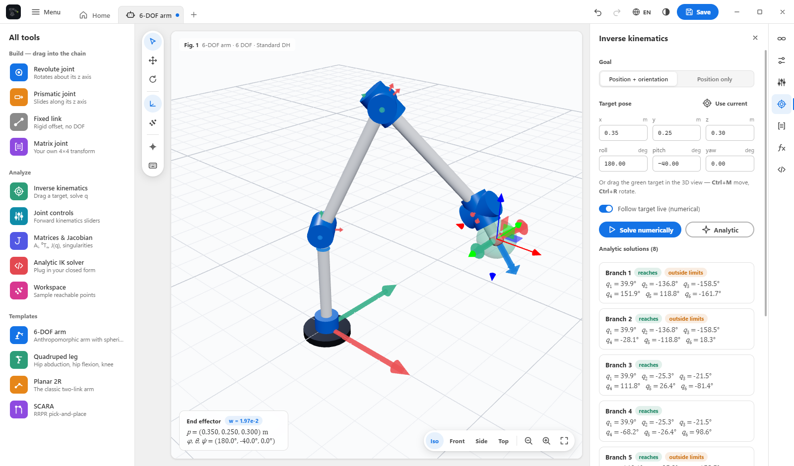
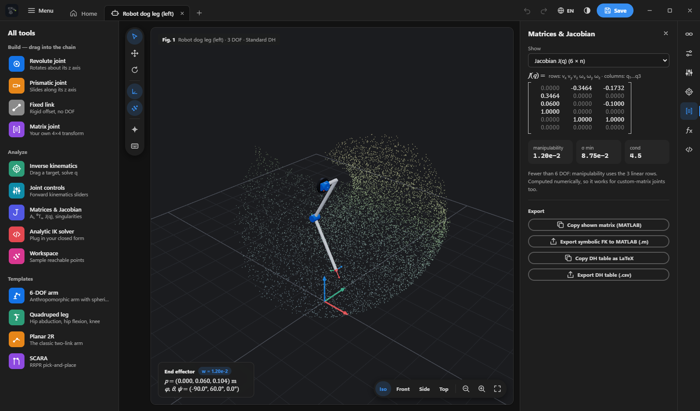
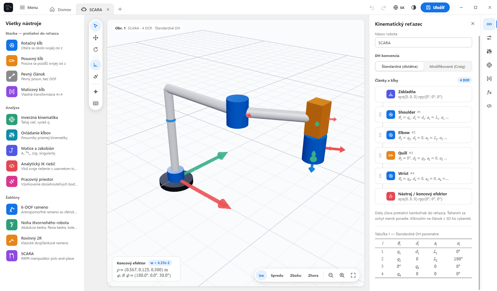

<p align="center">
  
</p>

<h1 align="center">BeanyIK</h1>

<p align="center">
  A drag &amp; drop robot kinematics builder for the desktop. Assemble a serial chain from joints,
  describe it with DH parameters or your own 4×4 matrices, and solve forward &amp; inverse kinematics live in 3D.
</p>

<p align="center">
  <a href="#showcase">Showcase</a> ·
  <a href="#features">Features</a> ·
  <a href="#getting-started">Getting started</a> ·
  <a href="#writing-your-own-analytic-ik">Analytic IK</a> ·
  <a href="#keyboard-shortcuts">Shortcuts</a> ·
  <a href="#terms-credits--license">Terms &amp; credits</a>
</p>

<p align="center">
  <a href="https://github.com/greenythebeany/BeanyIK/releases/latest">
    
  </a>
</p>

---

BeanyIK is GreenyBeany's tool for the robotics & cybernetics coursework: build the robot you're actually
working on (a 6-DOF arm, a robot dog leg, a SCARA…), check your DH table against a 3D model, drag a target
around and watch the IK solver move the arm, and compare your hand-derived closed-form solution against
the numerical one. The UI follows the layout of modern Adobe Acrobat: tab bar, an **All tools** panel,
a floating quick-tools rail beside the canvas, and an icon rail on the right that opens panels. Kinematics
are typeset the way a textbook would: θᵢ, dᵢ, aᵢ, αᵢ in a booktabs DH table, and matrices in square brackets.

## Showcase

<p align="center">
  
</p>
<p align="center"><i>6-DOF arm with a spherical wrist: the target is set, and all 8 closed-form branches are checked with FK.</i></p>

<p align="center">
  
</p>
<p align="center"><i>Quadruped leg in the dark theme, showing the Jacobian, manipulability and a sampled workspace cloud.</i></p>

<p align="center">
  
</p>
<p align="center"><i>SCARA with joint sliders, in the Slovak UI.</i></p>

## Features

- **Drag & drop chain builder.** Drag *Revolute*, *Prismatic*, *Fixed link* or *Matrix joint* parts from
  **All tools** into the chain (anywhere, or onto the 3D view to append). Drag the grip to reorder; click to edit.
- **Standard (distal) or modified (Craig) DH**: θ, d, a, α per joint, joint limits and home pose.
- **Custom matrix joints.** Type the 4×4 transform Aᵢ directly with expressions in `q`
  (e.g. `cos(q)`, `L1*sin(q)`). Useful when your course gives you the matrices rather than a DH table.
  The app checks that the rotation block is orthonormal.
- **Parameters.** Name your link lengths (`L1 = 0.3`, `L3 = L1 + L2`) and use them in every field.
  Fields accept `+ - * / ^`, `pi`, `sin`, `atan2`, `sqrt`, `deg()`/`rad()`…
- **Forward kinematics**: joint sliders, per-link Aᵢ, ⁰Tₙ, and an end-effector pose HUD.
- **Numerical IK**: damped least squares (Levenberg–Marquardt) on the Jacobian, with joint
  limits and random restarts. Choose position + orientation or position only. Drag the
  green target (`Ctrl+M` move / `Ctrl+R` rotate) and the robot follows live. Every drag is undoable.
- **Analytic IK.** Write your closed-form solution in the built-in editor. Every branch you return is
  verified with FK and flagged *reaches* or *outside limits*. Each template ships with a worked example.
- **Jacobian & singularities**: geometric Jacobian, manipulability, smallest singular value, det J, and a
  near-singularity warning.
- **Workspace cloud**: samples random configurations within the joint limits.
- **Export**: symbolic FK + Jacobian as a MATLAB `.m` script (Symbolic Math Toolbox), DH table as CSV or
  LaTeX, and any matrix as MATLAB.
- **English & Slovak UI.** Switch with the 🌐 EN/SK button in the top bar (Slovenčina is picked automatically on a Slovak system).
- **Tabs.** Open several robots at once, like documents in Acrobat. Each tab keeps its own pose, undo history, IK target and camera, and the whole set of tabs is restored on the next start.
- Robots save as readable `.robot.json`. Also included: undo/redo, recent files, autosave and light/dark themes.

### Templates

| Template | Joints | Analytic IK included |
| --- | --- | --- |
| 6-DOF arm | anthropomorphic arm + spherical wrist | 8 branches (shoulder × elbow × wrist flip) |
| Quadruped leg | hip abduction, hip flexion, knee | 4 branches |
| Planar 2R | two revolute links | elbow up / down |
| SCARA | R R P R | elbow left / right |

## Getting started

### Install (Windows)

Download the latest release from the [Releases page](https://github.com/greenythebeany/BeanyIK/releases/latest):

- **`BeanyIK-Setup-x.y.z.exe`**: installer with Start-menu and desktop shortcuts and an uninstaller.
- **`BeanyIK-Portable-x.y.z.exe`**: a single file that runs without installing.

The builds aren't code-signed, so on first launch Windows SmartScreen may say *"Windows protected your PC"*.
Click **More info → Run anyway**. Robots are saved to `Documents\BeanyIK` by default. The app checks GitHub for
new releases on start-up and tells you when one is available.

### Run from source

Requires [Node.js](https://nodejs.org) 18+.

```bash
git clone https://github.com/greenythebeany/BeanyIK.git
cd BeanyIK
npm install
npm start
```

Other scripts:

```bash
npm test        # headless kinematics self-test (FK, numerical IK, every template's analytic IK)
npm run dist    # build a Windows installer + portable exe into dist/
npm run vendor  # re-copy three.js from node_modules into renderer/vendor
```

## Units & conventions

- Lengths are in **metres**. In the editor, DH angles (θ, α), revolute limits/home and base/tool RPY are in **degrees**.
- Inside custom-matrix expressions and analytic solvers, `q` is in **radians** (revolute) or **metres** (prismatic).
- Standard DH: `Aᵢ = Rz(θ) Tz(d) Tx(a) Rx(α)`. Modified DH: `Aᵢ = Rx(αᵢ₋₁) Tx(aᵢ₋₁) Rz(θ) Tz(d)`.
- ⁰T_ee = T_base · A₁ ⋯ Aₙ · T_tool, with RPY as `Rz(yaw)·Ry(pitch)·Rx(roll)`. The world is Z-up.

## Writing your own analytic IK

Open **Analytic IK solver** (`</>` in the right rail). Your code is the body of a function:

```js
// T: target flange pose (4x4) in the chain's base frame — base and tool already removed
// P: your parameters (P.L1, ...)
// h: helpers — atan2, sqrt, acos, hypot, wrap, mul, transpose, rotation, fk(qPartial), ...
const { L1, L2 } = P;
const x = T[0][3], y = T[1][3];
const c2 = (x * x + y * y - L1 * L1 - L2 * L2) / (2 * L1 * L2);
if (Math.abs(c2) > 1) return [];
return [1, -1].map((s) => {
  const q2 = s * h.acos(c2);
  const q1 = h.atan2(y, x) - h.atan2(L2 * h.sin(q2), L1 + L2 * h.cos(q2));
  return [q1, q2];
});
```

Hit **Test on current pose**, or use **Analytic** in the IK panel to solve for the target and click a branch to apply it.

## Keyboard shortcuts

Press **F1** in the app for the full list.

| Key | Action |
| --- | --- |
| `Ctrl+M` | **Move mode**: drag the IK target (press again to leave) |
| `Ctrl+R` | **Rotate mode**: rotate the IK target |
| `Esc` | Back to select mode / clear selection |
| `Ctrl+Enter` / `Ctrl+Shift+Enter` | Solve IK numerically / analytically |
| `Ctrl+H` | Home pose |
| `Ctrl+T` (or `Ctrl+N`) | New robot in a new tab |
| `Ctrl+W` | Close the current tab (asks if there are unsaved changes) |
| `Ctrl+1` … `Ctrl+8` | Jump to tab: `Ctrl+1` is Home, `Ctrl+2` the first robot, … |
| `Ctrl+9` | Jump to the last tab |
| `Ctrl+Tab` / `Ctrl+Shift+Tab` | Next / previous tab |
| `Ctrl+O` / `Ctrl+S` / `Ctrl+Shift+S` | Open / save / save as |
| `Ctrl+Z` / `Ctrl+Y` | Undo / redo |
| `Ctrl+D` / `Delete` | Duplicate / delete the selected joint |
| `Ctrl+F` | Show / hide coordinate frames |
| `Ctrl+K` | Workspace cloud |
| `Ctrl+0` | Fit the robot in view |
| `Alt+1` … `Alt+4` | Iso / front / side / top view |
| `F1` | Keyboard shortcuts |

## Built with

Electron, [three.js](https://threejs.org) (vendored), and no other runtime dependencies. UI strings live in
`renderer/js/i18n.js`: English text is the key, so adding a language means adding one dictionary. The kinematics core
(`renderer/js/core`) is plain ES modules with no DOM access, so it runs under Node for the self-test.

## Terms, credits & license

- **License:** [MIT](LICENSE). Free to use, modify and share.
- **Terms of use & privacy:** [TERMS.md](TERMS.md). In short, it's an educational and design tool: don't use it
  as the only basis for moving real hardware. There is no telemetry, and the only network call is the GitHub update check.
- **Credits:** [CREDITS.md](CREDITS.md). The logo was generated with Google Gemini under GreenyBeany's art
  direction. The app uses the system fonts Segoe UI, Cambria Math and Cascadia Code (no font files bundled),
  plus Electron (MIT) and three.js (MIT). It also lists the kinematics references.

The same information is in the app under **Menu → About BeanyIK**.
