<p align="center">
  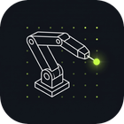
</p>

<h1 align="center">BeanyIK</h1>

<p align="center">
  <b>Poskladaj robota z dielov a nauč ho dosiahnuť cieľ.</b><br>
  Desktopová aplikácia na kinematiku robotov: pretiahni kĺby do reťazca, popíš ich DH parametrami alebo vlastnými
  maticami 4×4 a rieš priamu aj inverznú kinematiku naživo v 3D.
</p>

<p align="center">
  <a href="https://github.com/greenythebeany/BeanyIK/releases/latest"></a>
  <a href="https://github.com/greenythebeany/BeanyIK/releases"></a>
  
  <a href="LICENSE"></a>
</p>

<p align="center">
  <a href="README.md">English</a> · <b>Slovenčina</b> · <a href="https://greenythebeany.github.io/BeanyIK/">Webstránka</a>
</p>

<p align="center">
  <a href="https://github.com/greenythebeany/BeanyIK/releases/latest">
    
  </a>
</p>

<p align="center">
  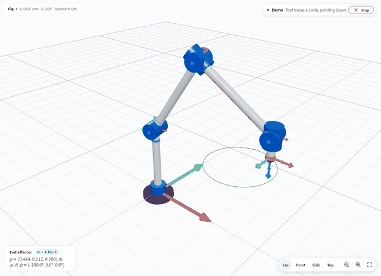
</p>

---

## Obsah

- [Čo to je](#čo-to-je)
- [Ukážky](#ukážky)
- [Funkcie](#funkcie)
- [Šablóny](#šablóny)
- [Inštalácia](#inštalácia)
- [Rýchly návod](#rýchly-návod)
- [Jednotky a konvencie](#jednotky-a-konvencie)
- [Vlastné analytické IK](#vlastné-analytické-ik)
- [Klávesové skratky](#klávesové-skratky)
- [Aktualizácie](#aktualizácie)
- [Časté otázky](#časté-otázky)
- [Vývoj](#vývoj)
- [Podmienky, poďakovanie a licencia](#podmienky-poďakovanie-a-licencia)

## Čo to je

BeanyIK vznikol ako pomôcka k štúdiu robotiky a kybernetiky. Postavíš si robota, na ktorom práve pracuješ
(6-osové rameno, nohu robotického psa, SCARA), porovnáš DH tabuľku so skutočným 3D modelom, potiahneš cieľ a
sleduješ, ako ho riešič dosiahne. Môžeš doň vložiť aj vlastné riešenie v uzavretom tvare a porovnať ho s numerickým.

Rozhranie je inšpirované Adobe Acrobatom: lišta s kartami, panel **Všetky nástroje** vľavo, rýchle nástroje vedľa
3D pohľadu a ikony vpravo, ktoré otvárajú panely. Kinematika je zapísaná ako v učebnici: θᵢ, dᵢ, aᵢ, αᵢ,
DH tabuľka v štýle odborných článkov a matice v hranatých zátvorkách.

## Ukážky

Každá šablóna po otvorení prehrá ukážku. Plánovaná dráha je čiarkovaná a nástroj za sebou zanecháva stopu.

<table>
  <tr>
    <td width="50%">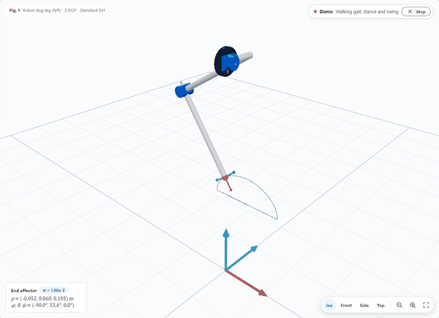<br><sub><b>Noha štvornohého robota</b>: chôdza s fázou opory a švihu, IK v každom snímku</sub></td>
    <td width="50%">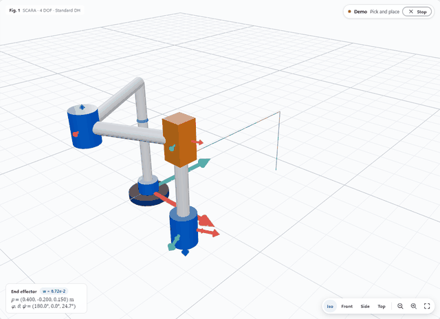<br><sub><b>SCARA</b>: prenesenie predmetu, posuvný kĺb ide hore a dole</sub></td>
  </tr>
  <tr>
    <td width="50%">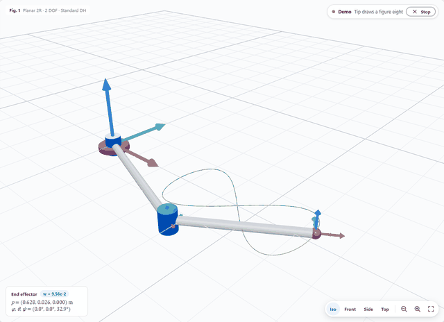<br><sub><b>Rovinný 2R</b>: hrot kreslí osmičku</sub></td>
    <td width="50%"><br><sub><b>6-osové rameno</b>: kruh s nástrojom stále nadol</sub></td>
  </tr>
</table>

### Inverzná kinematika

<p align="center">
  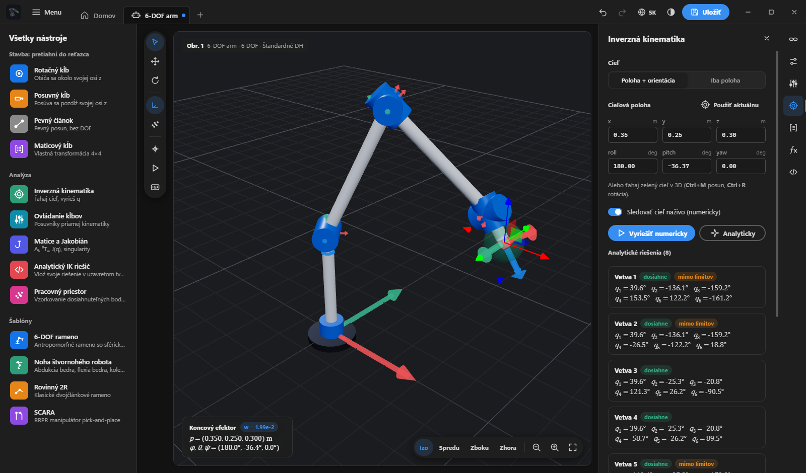
</p>
<p align="center"><sub>6-osové rameno so zadaným cieľom v tmavej téme. Všetkých osem vetiev riešenia sa overí priamou kinematikou a označí, ak porušujú limity kĺbov.</sub></p>

### Reťazec a jeho DH tabuľka

<table>
  <tr>
    <td width="50%">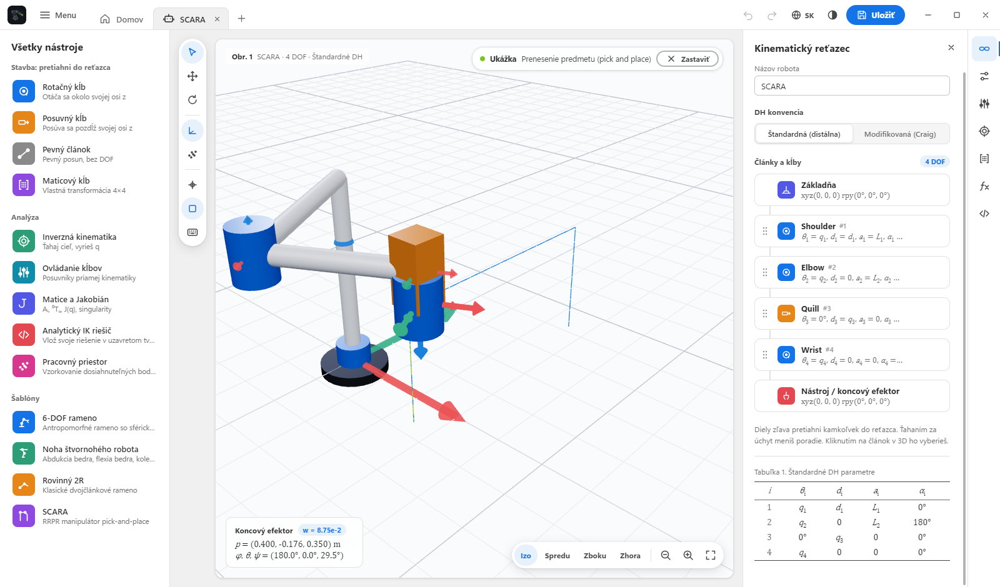<br><sub>Kinematický reťazec SCARA s DH tabuľkou</sub></td>
    <td width="50%">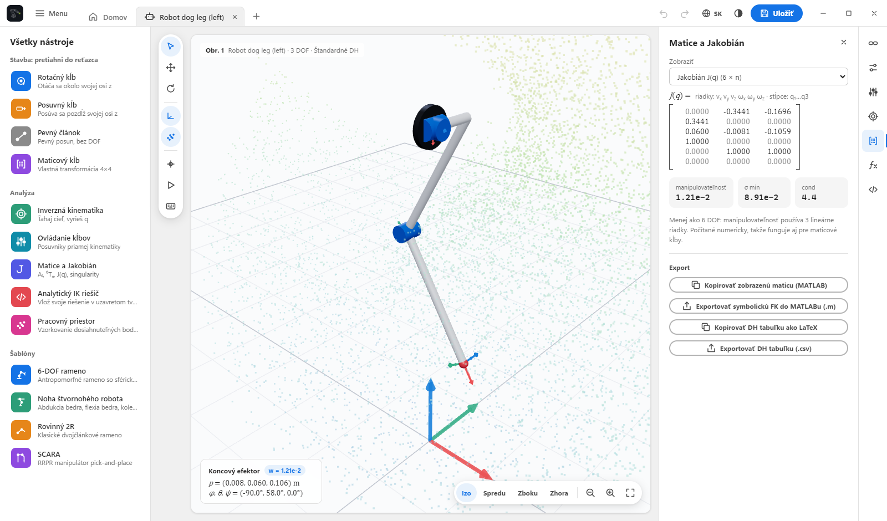<br><sub>Jakobián, manipulovateľnosť a mrak pracovného priestoru</sub></td>
  </tr>
  <tr>
    <td width="50%">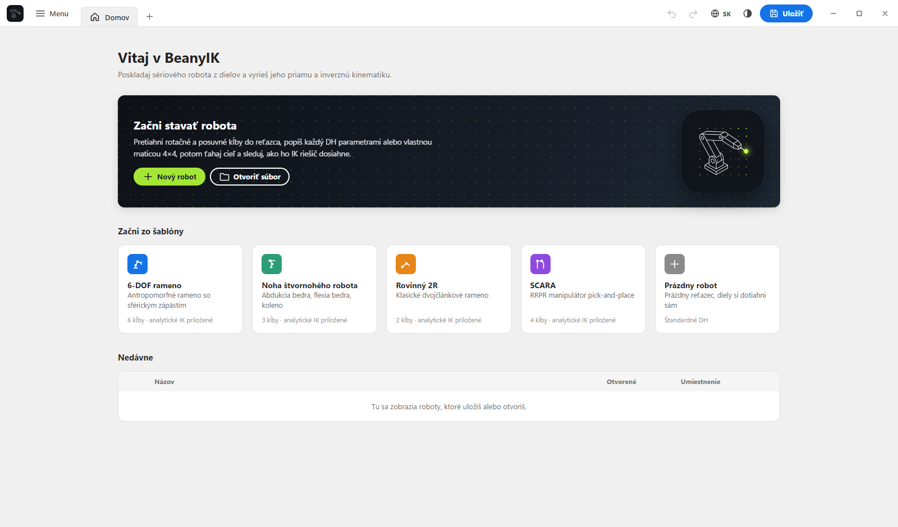<br><sub>Domovská obrazovka so šablónami</sub></td>
    <td width="50%">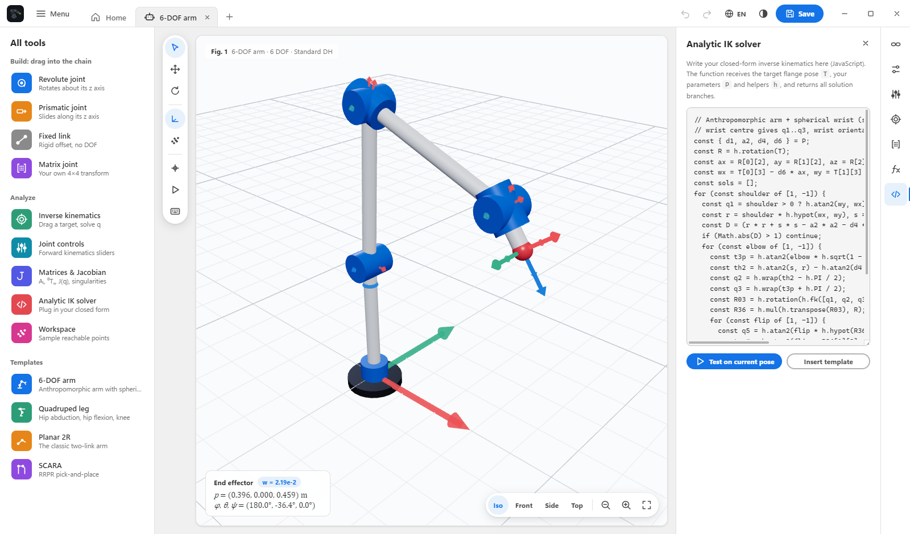<br><sub>Vlastné IK v uzavretom tvare priamo v aplikácii</sub></td>
  </tr>
  <tr>
    <td width="50%">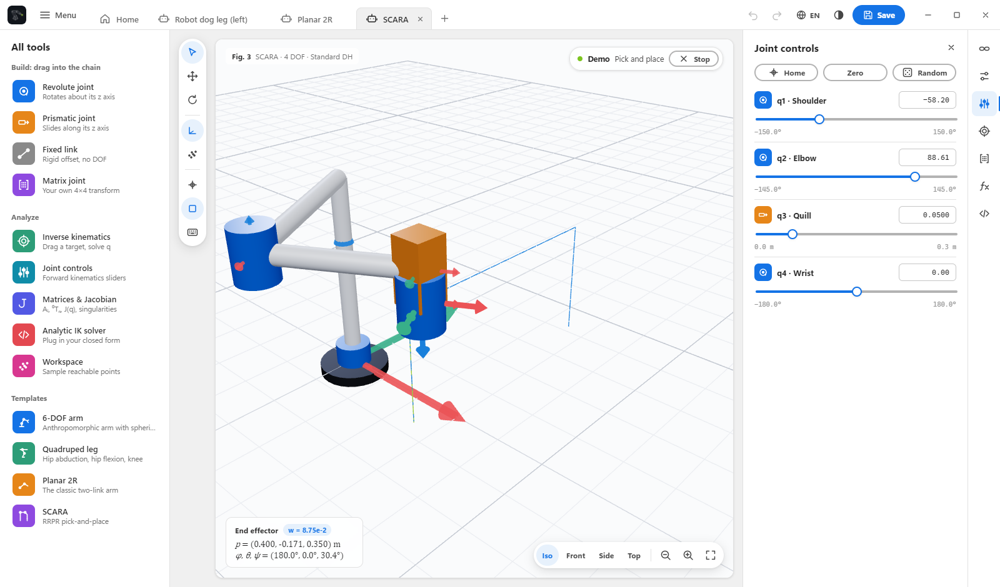<br><sub>Viac robotov naraz v kartách</sub></td>
    <td width="50%">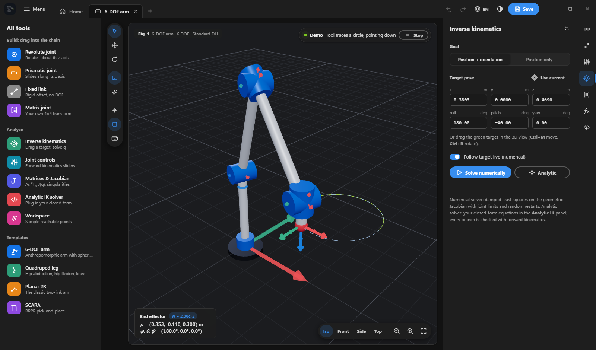<br><sub>Tmavá téma</sub></td>
  </tr>
</table>

## Funkcie

**Stavba**

- **Skladanie reťazca ťahaním.** Pretiahni *Rotačný kĺb*, *Posuvný kĺb*, *Pevný článok* alebo *Maticový kĺb*
  z panela **Všetky nástroje** kamkoľvek do reťazca, alebo ho pusti na 3D pohľad a pridá sa na koniec.
  Úchytom meníš poradie, kliknutím upravuješ.
- **Štandardná (distálna) alebo modifikovaná (Craig) DH konvencia** s θ, d, a, α pre každý kĺb, limitmi a domovskou polohou.
- **Natočenie kĺbov bez rozmýšľania o DH.** Každý kĺb má tlačidlá na naklonenie osi rotácie (0°, 90°, −90°, 180°)
  a na otočenie článku okolo nej. BeanyIK nastaví správne α alebo θ za teba.
- **Vlastné matice.** Zadaj transformáciu Aᵢ 4×4 priamo výrazmi s `q` (`cos(q)`, `L1*sin(q)`), keď máš zo školy
  matice namiesto DH tabuľky. Aplikácia skontroluje, že rotačná časť je naozaj rotácia.
- **Parametre.** Pomenuj dĺžky článkov (`L1 = 0.3`, `L3 = L1 + L2`) a používaj ich v každom poli. Polia prijímajú
  `+ - * / ^`, `pi`, `sin`, `atan2`, `sqrt`, `deg()` a `rad()`.

**Riešenie**

- **Priama kinematika** s posuvníkmi kĺbov, každou maticou Aᵢ, ⁰Tₙ a živým zobrazením polohy nástroja.
- **Numerická IK** metódou tlmených najmenších štvorcov na Jakobiáne s limitmi kĺbov. Iba poloha alebo poloha aj
  orientácia. Ťahaj cieľ (`Ctrl+M` posun, `Ctrl+R` rotácia) a robot ho nasleduje.
- **Žiadne preskakovanie.** Počas ťahania sa riešič pohybuje iba plynulo z aktuálnej polohy. Nikdy nepreskočí na
  druhú konfiguráciu lakťa a žiadny kĺb sa za snímok nepohne o viac ako pár stupňov, presne ako skutočné rameno.
  Skoky, o ktoré požiadaš (Vyriešiť, Domov, zadaná hodnota kĺbu, výber vetvy), prebehnú plynulo.
- **Analytická IK.** Riešenie v uzavretom tvare napíšeš priamo v editore. Každá vrátená vetva sa overí priamou
  kinematikou a označí ako *dosiahne* alebo *mimo limitov*.
- **Jakobián a singularity**: manipulovateľnosť, najmenšia singulárna hodnota, det J a varovanie pri singularite.
- **Pracovný priestor** ako mrak bodov z náhodných konfigurácií v rámci limitov.

**Ďalšie**

- **Animované ukážky** pre každú šablónu a prechod kĺbmi pre tvoje roboty (`Ctrl+P`).
- **Export** symbolickej FK a Jakobiánu do MATLABu (`.m`, Symbolic Math Toolbox), DH tabuľky do CSV alebo LaTeXu
  a ktorejkoľvek matice do MATLABu.
- **Karty** ako dokumenty v Acrobate. Každá si pamätá polohu, históriu zmien, IK cieľ aj kameru a po reštarte sa vrátia.
- **Angličtina a slovenčina**, svetlá a tmavá téma, späť a znova, nedávne súbory, automatické ukladanie.
- **Vstavaný aktualizátor**, ktorý novú verziu stiahne, overí a nainštaluje (pozri [Aktualizácie](#aktualizácie)).

## Šablóny

| Šablóna | Kĺby | Ukážka | IK v uzavretom tvare |
| --- | --- | --- | --- |
| 6-osové rameno | antropomorfné rameno so sférickým zápästím | kruh s nástrojom nadol | 8 vetiev (rameno, lakeť, zápästie) |
| Noha štvornohého robota | abdukcia bedra, flexia bedra, koleno | chôdza | 4 vetvy |
| Rovinný 2R | dva rotačné články | osmička | lakeť hore a dole |
| SCARA | R R P R | prenesenie predmetu | lakeť vľavo a vpravo |

## Inštalácia

### Windows

Stiahni z [najnovšieho vydania](https://github.com/greenythebeany/BeanyIK/releases/latest):

- **`BeanyIK-Setup-x.y.z.exe`** je inštalátor. Spýta sa na jazyk (angličtina alebo slovenčina), pridá odkazy do
  ponuky Štart a na plochu, odinštalátor a neskôr sa vie sám aktualizovať.
- **`BeanyIK-Portable-x.y.z.exe`** je jeden súbor, ktorý funguje bez inštalácie.

Zostavenia nie sú digitálne podpísané, preto Windows SmartScreen pri prvom spustení môže zobraziť
*„Systém Windows ochránil váš počítač“*. Klikni na **Ďalšie informácie** a potom **Spustiť aj tak**.

### macOS

Stiahni **`BeanyIK-x.y.z-mac-arm64.dmg`** pre Apple Silicon (M1 a novšie) alebo **`-mac-x64.dmg`** pre Macy s Intelom,
otvor ho a presuň BeanyIK do Aplikácií. Aplikácia nie je notarizovaná Applom (na to treba platený vývojársky účet),
preto prvé spustenie vyžaduje jeden krok navyše:

1. Otvor BeanyIK. macOS napíše, že aplikáciu nevie overiť. Klikni na **Hotovo**.
2. Otvor **Systémové nastavenia**, **Súkromie a bezpečnosť**, posuň sa nižšie a pri BeanyIK klikni na **Aj tak otvoriť**.
3. Potvrď heslom. Odvtedy sa otvára normálne.

Alebo naraz v Termináli:

```bash
xattr -dr com.apple.quarantine /Applications/BeanyIK.app
```

> BeanyIK 1.2.0 pre Mac mal poškodený podpis a macOS ho označil ako malvér. Použi **1.2.1 alebo novší**.

### Zo zdrojového kódu

Potrebuješ [Node.js](https://nodejs.org) 18 alebo novší.

```bash
git clone https://github.com/greenythebeany/BeanyIK.git
cd BeanyIK
npm install
npm start
```

## Rýchly návod

1. **Začni.** Na domovskej obrazovke vyber šablónu alebo **Nový robot** pre prázdny reťazec.
2. **Postav.** Ťahaj diely z **Všetkých nástrojov** do reťazca. Rotačný kĺb sa otáča okolo svojej osi z, posuvný sa
   po nej posúva a pevný článok je pevný posun (nasmeruješ ho tlačidlami *Hore*, *Dopredu*, *Dole*).
3. **Popíš.** Klikni na článok a vyplň θ, d, a, α, alebo ho prepni na *Vlastnú maticu* a zadaj Aᵢ. Dĺžky daj do
   **Parametrov**, aby si ich menil na jednom mieste.
4. **Hýb.** Otvor **Ovládanie kĺbov** a ťahaj posuvníky, alebo stlač `Ctrl+M` a ťahaj zelený cieľ. Panel vpravo
   ukáže výsledok IK a **Matice** všetky transformácie a Jakobián.
5. **Over si výpočty.** Napíš riešenie do **Analytického IK riešiča**, stlač **Otestovať na aktuálnej polohe** a každá
   vetva sa porovná s priamou kinematikou.
6. **Ulož a exportuj.** `Ctrl+S` uloží `.robot.json` do `Dokumenty\BeanyIK`. Panel Matice exportuje MATLAB, CSV aj LaTeX.

## Jednotky a konvencie

- Dĺžky sú v **metroch**. V editore sú DH uhly (θ, α), limity a domovské hodnoty rotačných kĺbov a natočenie
  základne a nástroja v **stupňoch**.
- Vo vlastných maticiach a analytických riešičoch je `q` v **radiánoch** (rotačný) alebo **metroch** (posuvný).
- Štandardná DH: `Aᵢ = Rz(θ) Tz(d) Tx(a) Rx(α)`. Modifikovaná DH: `Aᵢ = Rx(αᵢ₋₁) Tx(aᵢ₋₁) Rz(θ) Tz(d)`.
- ⁰T_ee = T_základňa · A₁ ⋯ Aₙ · T_nástroj, natočenie ako `Rz(yaw)·Ry(pitch)·Rx(roll)`. Os z smeruje nahor.

## Vlastné analytické IK

Otvor **Analytický IK riešič** (`</>` v pravej lište). Tvoj kód je telo funkcie:

```js
// T: cieľová poloha príruby (4x4) v základnej sústave reťazca, bez základne a nástroja
// P: tvoje parametre (P.L1, ...)
// h: pomocné funkcie ako atan2, sqrt, acos, hypot, wrap, mul, transpose, rotation, fk(qPartial)
const { L1, L2 } = P;
const x = T[0][3], y = T[1][3];
const c2 = (x * x + y * y - L1 * L1 - L2 * L2) / (2 * L1 * L2);
if (Math.abs(c2) > 1) return [];
return [1, -1].map((s) => {
  const q2 = s * h.acos(c2);
  const q1 = h.atan2(y, x) - h.atan2(L2 * h.sin(q2), L1 + L2 * h.cos(q2));
  return [q1, q2];
});
```

Stlač **Otestovať na aktuálnej polohe**, alebo **Analyticky** v paneli IK a kliknutím na vetvu sa k nej robot plynulo presunie.

## Klávesové skratky

Celý zoznam otvoríš v aplikácii klávesom **F1**. Na macOS použi Cmd namiesto Ctrl.

| Kláves | Akcia |
| --- | --- |
| `Ctrl+M` | Režim posunu, ťahanie IK cieľa (opätovným stlačením ho opustíš) |
| `Ctrl+R` | Režim rotácie, otáčanie IK cieľa |
| `Esc` | Späť do režimu výberu, zrušenie výberu |
| `Ctrl+Enter` / `Ctrl+Shift+Enter` | Vyriešiť IK numericky / analyticky |
| `Ctrl+P` | Prehrať alebo zastaviť ukážku |
| `Ctrl+H` | Domovská poloha |
| `Ctrl+T` | Nový robot v novej karte |
| `Ctrl+W` | Zavrieť kartu (spýta sa, ak máš neuložené zmeny) |
| `Ctrl+1` … `Ctrl+8` | Prejsť na kartu, `Ctrl+1` je Domov |
| `Ctrl+9` | Posledná karta |
| `Ctrl+Tab` / `Ctrl+Shift+Tab` | Ďalšia / predchádzajúca karta |
| `Ctrl+O` / `Ctrl+S` / `Ctrl+Shift+S` | Otvoriť / uložiť / uložiť ako |
| `Ctrl+Z` / `Ctrl+Y` | Späť / znova |
| `Ctrl+D` / `Delete` | Duplikovať / odstrániť vybraný kĺb |
| `Ctrl+F` | Zobraziť alebo skryť súradnicové sústavy |
| `Ctrl+K` | Mrak pracovného priestoru |
| `Ctrl+0` | Prispôsobiť pohľad robotovi |
| `Alt+1` … `Alt+4` | Pohľad izo, spredu, zboku, zhora |

## Aktualizácie

BeanyIK pri spustení skontroluje na GitHube, či vyšla nová verzia (vypneš to v **Menu**, **O aplikácii BeanyIK**).
Ak áno, okno ukáže novinky a tri možnosti:

- **Aktualizovať teraz** stiahne inštalátor priamo v aplikácii s ukazovateľom priebehu, overí jeho veľkosť a SHA-512,
  potom zatvorí BeanyIK a spustí ho. Otvorené roboty sa potom vrátia. Prenosná verzia stiahne nový prenosný súbor
  vedľa starého a spustí ho.
- **Neskôr** sa spýta nabudúce.
- **Preskočiť túto verziu** mlčí až do ďalšej verzie.

Na macOS okno odkáže na stránku na stiahnutie, pretože nepodpísaná aplikácia sa nemôže bezpečne nahradiť sama.

## Časté otázky

**Je to zadarmo?** Áno, pod licenciou MIT, bez účtov a bez reklám.

**Posiela niekam moje roboty?** Nie. Roboty, karty aj nastavenia zostávajú v tvojom počítači. Jediná sieťová
komunikácia je kontrola aktualizácií a, ak ju potvrdíš, stiahnutie z GitHub vydaní.

**Môžem tým riadiť skutočného robota?** Je to vzdelávací a návrhový nástroj. Použi ho na kontrolu výpočtov, nikdy
ako jediný podklad na pohyb skutočného hardvéru.

**V škole používame modifikovanú (Craig) konvenciu.** Prepni ju hore v paneli **Kinematický reťazec**. DH tabuľka
aj význam a a α sa prispôsobia.

**Mám iba matice, nie DH tabuľku.** Použi diely *Maticový kĺb* a zadaj každú Aᵢ s premennou `q`.

**Prečo sa rameno k vzdialenému cieľu hýbe pomaly?** Zámerne. Kĺby sú obmedzené na pár stupňov za snímok, aby rameno
nikdy nepreskočilo do inej konfigurácie, presne ako hardvér.

## Vývoj

```bash
npm start          # spustenie aplikácie
npm test           # test kinematiky, dráh ukážok a test proti preskakovaniu
npm run dist       # inštalátor a prenosná verzia pre Windows do dist/
npm run dist:mac   # dmg a zip pre macOS (na Macu)
npm run vendor     # skopíruje three.js z node_modules do renderer/vendor
```

Jadro kinematiky v `renderer/js/core` sú čisté ES moduly bez DOM, takže testy bežia v Node.
Texty rozhrania sú v `renderer/js/i18n.js`, kľúčom je anglický text, nový jazyk je teda jeden slovník navyše.

**Vydanie.** Zvýš verziu v `package.json` a pushni tag, napríklad `v1.2.0`. Workflow zostaví súbory pre Windows
aj macOS a priloží ich spolu s `latest.yml` pre aktualizátor k vydaniu na GitHube.

**Webstránka.** Stránka v priečinku `website/` je React aplikácia (Vite), ktorú workflow pri každom pushi do main
nasadí na GitHub Pages.

## Podmienky, poďakovanie a licencia

- **Licencia:** [MIT](LICENSE).
- **Podmienky používania a súkromie:** [TERMS.sk.md](TERMS.sk.md) ([English](TERMS.md)).
- **Poďakovanie:** [CREDITS.md](CREDITS.md). Logo bolo vygenerované pomocou Google Gemini podľa návrhu GreenyBeany.
  Aplikácia používa systémové písma Segoe UI, Cambria Math a Cascadia Code (žiadne súbory písiem nie sú pribalené),
  Electron (MIT) a three.js (MIT). V CREDITS.md je aj použitá literatúra.

Vytvoril [GreenyBeany](https://github.com/greenythebeany).
